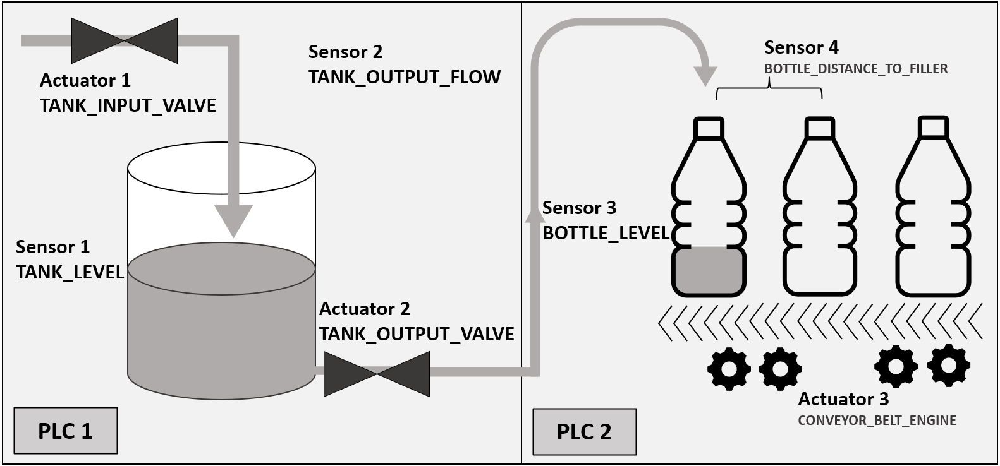

# ICSSIM

## Credits and citation

This project uses the ICSSIM framework and its sample bottle-filling testbed. It was created by Alireza Dehlaghi-Ghadim, Ali Balador, Mahshid Helali Moghadam, Hans Hansson, and Mauro Conti.

- Original repository: https://github.com/AlirezaDehlaghi/ICSSIM
- Paper: A. Dehlaghi-Ghadim, A. Balador, M. Helali Moghadam, H. Hansson, and M. Conti, “ICSSIM — A framework for building industrial control systems security testbeds,” *Computers in Industry*, vol. 148, 103906, 2023.
- DOI: https://doi.org/10.1016/j.compind.2023.103906

If you use this work, cite the original paper:

```bibtex
@article{DehlaghiGhadim2023ICSSIM,
  title   = {ICSSIM — A framework for building industrial control systems security testbeds},
  author  = {Dehlaghi-Ghadim, Alireza and Balador, Ali and Helali Moghadam, Mahshid and Hansson, Hans and Conti, Mauro},
  journal = {Computers in Industry},
  volume  = {148},
  pages   = {103906},
  year    = {2023},
  doi     = {10.1016/j.compind.2023.103906}
}
```

# Sample bottle-filling factory

The factory uses a water tank to fill bottles. The process has two hardware zones, each controlled by its own PLC:

- PLC-1 controls the water tank and valves.
- PLC-2 controls the conveyor belts, which move filled bottles out and empty bottles in.



The network uses the first three layers of the Purdue reference architecture. Docker shared memory connects Tiers 1 and 2. A simulated LAN connects Tiers 2 and 3. The attacker is assumed to have access to this LAN as a malicious HMI, so it is included as an additional attacker node.


# Run the sample bottle-filling factory

## Run with Docker

### Before you start

Install:

- git
- Docker (on Windows, use the latest Docker Desktop)
- Docker Compose (included in Docker Desktop as `docker compose`)

### Get ICSSIM

Clone the repository:

```bash
git clone https://github.com/AlirezaDehlaghi/ICSSIM ICSSIM
```

In `src/Configs.py`, set `EXECUTION_MODE` to `EXECUTION_MODE_DOCKER`:

```python
EXECUTION_MODE = EXECUTION_MODE_DOCKER
```

### Start the sample project

Run the prepared script:

```bash
cd ICSSIM/deployments
./init.sh
```

On Windows PowerShell, use the start sequence in [Dataset Capture Manual (Windows + Docker Desktop)](#dataset-capture-manual-windows--docker-desktop).

### Check that it started

If `init.sh` finishes, it should show the status of all containers. The project is running if all containers show `Up`.

You can also check with:

```bash
sudo docker-compose ps
```

### Use the control system and run attacks

The `deployments` directory has scripts that connect you to containers, including:

- `deployments/hmi1.sh`
- `deployments/hmi2.sh`
- `deployments/attacker.sh`

## Run in GNS3

Clone the project:

```bash
git clone https://github.com/AlirezaDehlaghi/ICSSIM ICSSIM
```

Import the portable project, `deployments/GNS3/ICSSIM-GNS3-Portable.gns3project`, using **File → Import Portable Project** in GNS3.

## Run as a single Python project

> **Note:** Local mode runs everything in one Python process over `127.0.0.1`. It is useful for testing the logic, but it does not create a realistic network: there are no separate IP addresses, MAC addresses, or ARP. Local mode is not used for dataset capture. Use Docker mode to capture datasets.

### Before you start

Install:

- git
- Python (3.11 or 3.12 recommended)
- pip

Install the required packages:

```bash
pip install pyModbusTCP
pip install python-memcached
```

### Get ICSSIM and set the mode

Clone the repository:

```bash
git clone https://github.com/AlirezaDehlaghi/ICSSIM ICSSIM
```

In `src/Configs.py`, set `EXECUTION_MODE` to `EXECUTION_MODE_LOCAL`:

```python
EXECUTION_MODE = EXECUTION_MODE_LOCAL
```

### Start the project

Run `start.py`. On Windows, use `python` instead of `python3`.

```bash
cd ICSSIM/src
python3 start.py
```

---

# Dataset Capture Manual (Windows + Docker Desktop)

This section explains how to capture:

- **Benign traffic** for training.
- **Benign and attack traffic** for testing.

It also explains how to convert the captures to CSV with `icssim_to_csv.py`.

Run the commands in PowerShell from `ICSSIM\deployments`, unless a step says otherwise.

## 0. Capture plan

| # | Capture | Purpose | Length | Output |
|---|---|---|---|---|
| 1 | Benign | Train the model on normal behaviour | 2 h | `benign_2h.pcap` |
| 2 | Mixed (benign + attacks) | Test detection with labelled attacks | ~2 h | `mixed_2h.pcap` + `attacker_summary.csv` |
| 3 | Benign (optional, another day) | Measure false alarms on unseen normal traffic | 30–60 min | `benign_val.pcap` |

### Sample factory network details

These are the addresses observed on the `icsnet` bridge in a sample run. MAC addresses are regenerated each time the containers are rebuilt, so always refresh them with step 2.2.

| Item | Value |
|---|---|
| Capture interface (bridge of `icsnet`) | `br_icsnet` (`192.168.0.1/24`) |
| PLC1 / PLC2 | `192.168.0.11:502` / `192.168.0.12:502` |
| HMI1 / HMI2 / HMI3 | `192.168.0.21` / `.22` / `.23` |
| Attacker (interactive menu) | `attacker` → `192.168.0.42` |
| Other attacker nodes | `attackermachine` → `192.168.0.41`, `attackerremote` → `192.168.0.43` |
| Physical process link | `phynet` network + memcached (not captured) |

### Expected benign traffic volume

These figures are from earlier runs, at about 90 Modbus packets per second.

| | per 1 h | per 2 h |
|---|---|---|
| Modbus transactions (request + response) | ~160,000 | ~320,000 |
| Modbus packets (= CSV rows) | ~320,000 | ~640,000 |
| Total packets (incl. TCP ACKs) | ~0.5–1 M | ~1–2 M |
| TCP sessions | ~7–8 | ~7–8 |

## 1. Prepare the machine

Do this once per machine.

1. Update Docker Desktop to the latest version.
2. In `src\Configs.py`, set `EXECUTION_MODE = EXECUTION_MODE_DOCKER`.
3. Create a folder for the captures:

   ```powershell
   mkdir C:\captures -Force
   ```

4. Disable sleep while capturing: *Settings → System → Power → Sleep = Never*.
5. Install the converter’s Python packages:

   ```powershell
   pip install scapy pandas
   ```

6. In `icssim_to_csv.py`, use streaming reads. Large captures can otherwise need several GB of RAM.

   Change:

   ```python
   from scapy.all import IP, TCP, rdpcap
   ...
   for pkt in rdpcap(pcap_path):
   ```

   to:

   ```python
   from scapy.all import IP, TCP, PcapReader
   ...
   for pkt in PcapReader(pcap_path):
   ```

## 2. Start the network

### 2.1 Start the simulator first

Start the physical simulator (`pys`) before the PLCs. If the PLCs start first, they read empty sensor values and **PLC2 crashes** with `TypeError: 'NoneType' object is not subscriptable`.

```powershell
cd C:\Users\<user>\PycharmProjects\ICSSIM\deployments
docker compose down
docker compose up -d pys
Start-Sleep -Seconds 15
docker compose up -d
docker ps
```

All ICSSIM containers should show `Up`:

```text
pys, plc1, plc2, hmi1, hmi2, hmi3, attacker, attackermachine, attackerremote
```

> After changing `Configs.py` or source code, rebuild with `docker compose up -d --build`.

### 2.2 Record the node addresses

Save the node addresses for labeling the data. MACs change on every rebuild, so capture them fresh each run:

```powershell
docker inspect -f "{{.Name}} {{range .NetworkSettings.Networks}}{{.IPAddress}} {{.MacAddress}} {{end}}" plc1 plc2 hmi1 hmi2 hmi3 attacker attackermachine attackerremote > C:\captures\nodes.txt
type C:\captures\nodes.txt
```

### 2.3 Create the attacker log folder

The attacker writes its ground-truth log to `./logs/attack-logs/` inside the container. **This folder does not exist by default**, and without it the attacker fails to log an attack (and command injection crashes the container). Create it before running any attack:

```powershell
docker exec attacker sh -c "mkdir -p ./logs/attack-logs && chmod -R 777 ./logs"
docker exec attacker sh -c "ls -la ./logs/attack-logs"
```

## 3. Check that the containers are healthy

Wait about 30 seconds after starting the network, then check the logs:

```powershell
docker logs pys  --tail 10
docker logs plc1 --tail 10
docker logs plc2 --tail 10
```

| Container | Healthy | If it is not healthy |
|---|---|---|
| `pys` | Shows `Starting memcached`, `Created`, and `started`; overflow / “water is wasting” warnings happen only occasionally | A constant stream of warnings means the PLCs are not controlling the process. Restart using step 2.1 |
| `plc1` | No continuous `receive null value for tag` warnings | Restart using step 2.1 |
| `plc2` | No `Traceback` | Restart using step 2.1 |

Optional: attach to an HMI to check it visually. Detach with **Ctrl+P, Ctrl+Q**, not Ctrl+C.

```powershell
docker attach hmi1
```

## 4. Find the capture interface

Run:

```powershell
docker run --rm --net=host nicolaka/netshoot ip -br addr | findstr 192.168.0
```

Expected output includes:

```text
br_icsnet  UP  192.168.0.1/24 ...
```

The interface name is **`br_icsnet`**.

## 5. Test the capture (30 seconds)

Capture a short test:

```powershell
docker run --rm --net=host --cap-add NET_ADMIN -v C:\captures:/cap nicolaka/netshoot `
  timeout 30 tcpdump -i br_icsnet -w /cap/test.pcap
```

Check that Modbus packets are in the capture:

```powershell
# Look for Modbus packets between 192.168.0.11/.12 and .21/.22/.23
docker run --rm -v C:\captures:/cap nicolaka/netshoot tcpdump -nr /cap/test.pcap port 502 -c 20

# Show TCP sessions (all, then only sessions carrying Modbus)
docker run --rm -v C:\captures:/cap nicolaka/netshoot tshark -r /cap/test.pcap -q -z conv,tcp
docker run --rm -v C:\captures:/cap nicolaka/netshoot tshark -r /cap/test.pcap -q -z "conv,tcp,mbtcp"

# Count requests and responses. The counts should be almost equal.
# Multiply by 120 to estimate transactions per hour.
docker run --rm -v C:\captures:/cap nicolaka/netshoot sh -c "tshark -r /cap/test.pcap -Y 'mbtcp && tcp.dstport==502' 2>/dev/null | wc -l"
docker run --rm -v C:\captures:/cap nicolaka/netshoot sh -c "tshark -r /cap/test.pcap -Y 'mbtcp && tcp.srcport==502' 2>/dev/null | wc -l"
```

## 6. Capture benign traffic (2 hours)

After the network is healthy, wait 1–2 minutes and start the capture:

```powershell
docker run --rm --net=host --cap-add NET_ADMIN -v C:\captures:/cap nicolaka/netshoot `
  timeout 7200 tcpdump -i br_icsnet -w /cap/benign_2h.pcap
```

During the capture:

- Keep the PowerShell window open and the PC awake.
- **Do not** attach to or use `attacker`, `attackermachine`, or `attackerremote`.
- You can leave the HMIs alone. HMI2 and HMI3 generate normal operator traffic.
- Write down the capture start time in the log in step 10.

After the capture, check it:

```powershell
docker run --rm -v C:\captures:/cap nicolaka/netshoot capinfos /cap/benign_2h.pcap
```

The duration should be about 7200 seconds.

## 7. Capture benign and attack traffic (about 2 hours)

1. Restart the testbed using step 2.1, then run steps 2.2, 2.3 (log folder) and 3 (health checks).
2. **Clear any stale logs** from a previous run so old files are not mixed in:

   ```powershell
   docker exec attacker sh -c "rm -f ./logs/attack-logs/*"
   ```

3. Start the capture:

   ```powershell
   docker run --rm --net=host --cap-add NET_ADMIN -v C:\captures:/cap nicolaka/netshoot `
     timeout 7200 tcpdump -i br_icsnet -w /cap/mixed_2h.pcap
   ```

4. In a **second** PowerShell window, open the attacker menu. Use `docker exec` with a UTF-8 terminal, **not** `docker attach`. The interactive attacker exits (status `Exited (0)`) when its input stream closes, and `docker attach` can feed it bytes it cannot decode (`UnicodeDecodeError`), which kills the container mid-capture.

   ```powershell
   docker exec -it -e PYTHONIOENCODING=utf-8 attacker bash
   ```

   Inside the container, start the menu:

   ```bash
   ./start.sh Attacker.py
   ```

5. Choose attacks from the attacker menu, one at a time. Leave about 10 minutes of normal traffic between attacks. At each `press inter to continue` prompt, press **Enter only** (other keys can crash the menu).

   | Time from capture start | Action | MITRE ATT&CK for ICS |
   |---|---|---|
   | 0–15 min | nothing (benign) | – |
   | ~15 min | port scan | T0846 |
   | ~25 min | IP scan | T0846 |
   | ~35 min | command injection | T0855 |
   | ~50 min | DDoS | T0814 |
   | ~65 min | MITM | T0830 |
   | ~80 min | replay | T0831 |
   | 80–120 min | nothing (benign) | – |

   As a backup, write down each attack’s wall-clock start and end times in the capture log. When finished, type `exit` to leave the container (the menu session ends and the `attacker` container stops — this is expected).

6. **Verify each attack actually produced traffic before moving on.** MITM and replay only work when the attacker sits between two nodes that are actively talking, and they can otherwise log `Changed 0 packets` or `Sniffed 0 packets` — meaning nothing malicious entered the PCAP even though the window is labelled. For MITM/replay, pick a victim pair with live traffic, such as HMI1 (`192.168.0.21`) and PLC1 (`192.168.0.11`), and give the attack a long enough window. Check the per-attack log reports a non-zero count:

   ```powershell
   docker exec attacker sh -c "cat ./logs/attack-logs/log-mitm-scapy.txt"
   docker exec attacker sh -c "cat ./logs/attack-logs/log-replay-scapy.txt"
   ```

7. Get the attacker’s ground-truth log and the per-attack logs. The summary CSV (`attacker_summary.csv`) has the columns the converter needs: `attack, startStamp, endStamp, startTime, endTime, attackerMAC, attackerIP, description`.

   ```powershell
   # copy the whole logs tree out of the container
   docker cp attacker:/src/logs C:\captures\logs_mixed
   # locate the summary and per-attack files
   dir C:\captures\logs_mixed -Recurse
   ```

   Only the interactive `attacker` node (`.42`) writes a populated summary; `attackermachine` and `attackerremote` stay empty unless you drive them too. Copy the populated `attacker_summary.csv` to `C:\captures\attack_log.csv` for the converter, and confirm every `startStamp`/`endStamp` falls within the capture time range shown by `capinfos`.

## 8. Convert the captures to CSV

### Convert the benign capture

Make an empty attack log with a header row:

```powershell
"attack,startStamp,endStamp,startTime,endTime,attackerMAC,attackerIP,description" | Out-File -Encoding ascii C:\captures\empty_log.csv
```

Run the converter:

```powershell
python icssim_to_csv.py C:\captures\benign_2h.pcap C:\captures\empty_log.csv --out-dir C:\captures\benign --split-benign
```

Use `C:\captures\benign\benign_train.csv` for training.

### Convert the mixed capture

```powershell
python icssim_to_csv.py C:\captures\mixed_2h.pcap C:\captures\attack_log.csv --out-dir C:\captures\mixed
```

Use `C:\captures\mixed\icssim_all.csv` for testing.

The CSV has one row per Modbus packet, request or response:

```text
ts, src_ip, dst_ip, func_code, start_addr, quantity, latency_ms, exception, label
```

## 9. Check the dataset

Run:

```powershell
python -c "import pandas as pd; d=pd.read_csv(r'C:\captures\mixed\icssim_all.csv'); print(d.shape); print(d.label.value_counts()); print(pd.concat([d.src_ip,d.dst_ip]).value_counts())"
```

Check that:

- [ ] All rows in the benign CSV have the label `benign`.
- [ ] The benign CSV has IPs `.11`, `.12`, `.21`, `.22`, and `.23`.
- [ ] The mixed CSV has attack labels, not just `benign`.
- [ ] Attacker IP (`192.168.0.42`) appears in the mixed CSV for command injection and DDoS.
- [ ] `benign_train.csv` and `icssim_all.csv` are not identical. Check with `Get-FileHash`.

### Converter limitations

- **Scans:** port scans (SYN probes) and IP scans (ARP) have no Modbus payload, so they are not in the CSV. They are still in the PCAP. The scan windows are in `attacker_summary.csv` if you need them.
- **MITM and replay:** these keep the original PLC/HMI IPs, so the converter’s IP match does not catch them. Label these by the attacker **MAC** from `nodes.txt` / `attacker_summary.csv`, not by IP. Also confirm they captured non-zero packets (step 7.6) — otherwise the window has no attack traffic to detect.
- **Command injection:** make sure the attacker log folder exists (step 2.3) before running it, or the attack is not logged.
- **Responses:** `start_addr` and `quantity` are not real fields in responses. FC3 responses carry register data, so parse these fields for requests only.

## 10. Keep a capture log

Fill this in for every capture:

| File | Date | Start (local) | End (local) | Duration (s) | Packets (`capinfos`) | Notes / attacks |
|---|---|---|---|---|---|---|
| benign_2h.pcap | | | | | | |
| mixed_2h.pcap | | | | | | |

## 11. Stop the testbed

```powershell
docker compose down
```

## Troubleshooting

| Problem | Cause | Fix |
|---|---|---|
| `PLC2 ... TypeError: 'NoneType' object is not subscriptable` | PLCs started before `pys` | Restart using step 2.1 |
| `pys` repeatedly shows “bottle water overflowed” | PLC2 crashed or PLC1 gets null values | Restart using step 2.1 |
| `WinError 10049` when running `start.py` | Docker IPs are being used in local mode | Use Docker mode for capture |
| `no configuration file provided: not found` | `docker compose` run outside `deployments` | `cd` into `ICSSIM\deployments` first |
| `attacker` shows `Exited (0)` | Interactive menu ended or input stream closed | Restart with `docker compose up -d attacker`, then use `docker exec` (step 7.4) |
| `UnicodeDecodeError ... 'utf-8' codec can't decode` in the attacker | `docker attach` sent undecodable bytes to `input()` | Use `docker exec -it -e PYTHONIOENCODING=utf-8 attacker bash`; press Enter only |
| `chmod: cannot access './logs/attack-logs/...': No such file` | Log folder missing | Create it with step 2.3 before running attacks |
| MITM/replay log says `Changed 0 packets` / `Sniffed 0 packets` | No live traffic between the chosen victims, or window too short | Target a busy pair (e.g. `.21` ↔ `.11`) and lengthen the window (step 7.6) |
| Per-attack log has an old date | Stale file from a previous run | Clear the folder first (step 7.2) |
| `br_icsnet` is missing in step 4 | The network was not created or has a different name | Run `docker network inspect icsnet` |
| Mixed-run CSV has only `benign` labels | Attacks were outside the capture window or the wrong log was used | Check `capinfos` against the `attacker_summary.csv` timestamps |
| Converter is very slow or runs out of memory | `rdpcap` loads the whole PCAP | Use `PcapReader` as shown in step 1.6 |
| `"clear" ist entweder falsch geschrieben` | Linux `clear` was used on Windows (local mode only) | Use `os.system('cls' if os.name == 'nt' else 'clear')` |