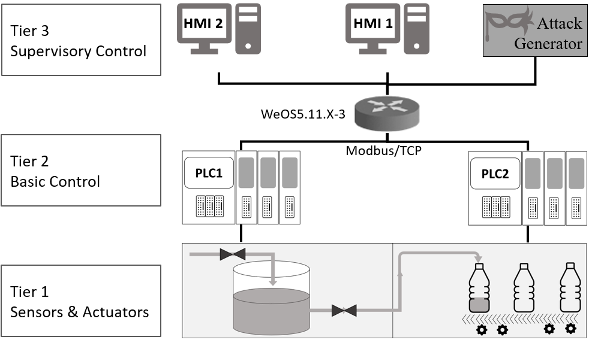

# ICSSIM
This is the ICSSIM source code and user manual for simulating industrial control system testbed for cybersecurity experiments.

The ICSSIM framework enables cyber threats and attacks to be investigated and mitigated by building a virtual ICS security testbed customized to suit their needs. As ICSSIM runs on separate private operating system kernels, it provides realistic network emulation and runs ICS components on Docker container technology.

ICSSIM can also be used to simulate any other open-loop controlling process, such as bottle filling, and allows us to build a testbed for any open-loop controlling process.

# Sample Bottle Filling Factory
A water tank repository is used to fill bottles during the bottle-filling factory control process. The below figure shows the overall scenario including process and hardware. The proposed control process consists of two main hardware zones, each managed by a standalone PLC, called PLC-1 and PLC-2. The water tank and valves are controlled by PLC-1. The conveyor belts are controlled by PLC-2 to switch out filled bottles with empty ones.


An overview of the bottle filling factory network architecture is presented below. In the proposed network architecture, the first three layers of the Purdue reference architecture are realized. In Docker container technology, shared memory is used to implement the hard wired connection between Tiers 1 and 2. To simulate the network between Tiers 2 and 3, a Local Area Network (LAN) is created in a simulation environment. The attacker is also assumed to have access to this network as a malicious HMI, therefore we consider this node as an additional attacker in this architecture.




# Run a Sample Bottle Filling Factory

## Run in Docker container Environment

### Pre steps
Make sure that you have already installed the following applications and tools.

* git
* Docker (on Windows: Docker Desktop, kept up to date)
* Docker-Compose (included in Docker Desktop as `docker compose`)

### Getting ICSSIM and the sample project
Clone the project into your local directory using following git command.
```
git clone https://github.com/AlirezaDehlaghi/ICSSIM ICSSIM
```

Check the file [Configs.py](src/Configs.py) and make sure that the EXECUTION_MODE variable is set to EXECUTION_MODE_DOCKER as follows:
```
EXECUTION_MODE = EXECUTION_MODE_DOCKER
```

### Running the sample project
Run the sample project using the prepared script
[init.sh](deployments/init.sh)
```
cd ICSSIM/deployments
./init.sh
```
On Windows (PowerShell), see [Dataset Capture Manual](#dataset-capture-manual-windows--docker-desktop) below for the equivalent start sequence.

### Check successful running
If *init.sh* commands runs to the end, it will show the status of all containers. In the case that all containers are 'Up', then project is running successfully.
You could also see the status of containers with following command:
```
sudo docker-compose ps
```

### Operating the control system and apply cyberattacks
In the directory [deployments](deployments/) there exist some scripts such as [hmi1.sh](deployments/hmi1.sh), [hmi2.sh](deployments/hmi2.sh) or [attacker.sh](deployments/attacker.sh) which can attach user to the container.

## Run in GNS3
To run the ICSSIM and the sample Bottle Filling factory clone the project and use the portable GNS3 file to create a new project in GNS3.

### Getting ICSSIM and the sample project
Clone the project into your local directory using following git command.
```
git clone https://github.com/AlirezaDehlaghi/ICSSIM ICSSIM
```

### Import Project in GNS3
Import the portable project ([deployments/GNS3/ICSSIM-GNS3-Portable.gns3project](deployments/GNS3/ICSSIM-GNS3-Portable.gns3project)) using menu **File->Import Portable Project**

## RUN as a single Python project

> **Note:** local mode runs all components in one Python process over `127.0.0.1`. It is useful for testing the logic, but it does **not** produce a realistic network (no separate IPs, MACs or ARP) and is **not** used for dataset capture. Use Docker mode for datasets.

### Pre steps
Make sure that you have already installed the following applications and tools.

* git
* Python (3.11 or 3.12 recommended)
* pip

Make sure that you installed required packages: pyModbusTCP, python-memcached
```
pip install pyModbusTCP
pip install python-memcached
```

### Getting ICSSIM and the sample project
Clone the project into your local directory using following git command.
```
git clone https://github.com/AlirezaDehlaghi/ICSSIM ICSSIM
```

Check the file [Configs.py](src/Configs.py) and make sure that the EXECUTION_MODE variable is set to EXECUTION_MODE_LOCAL as follows:
```
EXECUTION_MODE = EXECUTION_MODE_LOCAL
```

### Running the sample project
Run the sample project using the running start.py (on Windows use `python` instead of `python3`)
```
cd ICSSIM/src
python3 start.py
```

---

# Dataset Capture Manual (Windows + Docker Desktop)

This section describes how to produce a **benign** dataset (for training) and a **mixed benign + attack** dataset (for testing) from the ICSSIM Docker testbed, and how to convert the captures to CSV with `icssim_to_csv.py`.

All commands are for **PowerShell**, run from `ICSSIM\deployments` unless stated otherwise.

## 0. Overview

| # | Capture | Purpose | Length | Output |
|---|---|---|---|---|
| 1 | Benign | Train the model on normal behaviour | 2 h | `benign_2h.pcap` |
| 2 | Mixed (benign + attacks) | Test detection with labelled attacks | ~2 h | `mixed_2h.pcap` + `attack_log.csv` |
| 3 | Benign (optional, another day) | Measure false alarms on unseen normal traffic | 30–60 min | `benign_val.pcap` |

Network facts for the sample factory:

| Item | Value |
|---|---|
| Capture interface (bridge of `icsnet`) | `br_icsnet` (`192.168.0.1/24`) |
| PLC1 / PLC2 | `192.168.0.11:502` / `192.168.0.12:502` |
| HMI1 / HMI2 / HMI3 | `192.168.0.21` / `.22` / `.23` |
| Attackers | `attacker`, `attackermachine`, `attackerremote` (IPs: see step 2.2) |
| Physical process link | `phynet` network + memcached (not captured) |

Expected benign volume (from earlier runs, ≈ 90 Modbus packets/s):

| | per 1 h | per 2 h |
|---|---|---|
| Modbus transactions (request + response) | ~160,000 | ~320,000 |
| Modbus packets (= CSV rows) | ~320,000 | ~640,000 |
| Total packets (incl. TCP ACKs) | ~0.5–1 M | ~1–2 M |
| TCP sessions | ~7–8 | ~7–8 |

## 1. Prepare (once per machine)

1. Update Docker Desktop to the latest version.
2. Set `EXECUTION_MODE = EXECUTION_MODE_DOCKER` in `src\Configs.py`.
3. Create the output folder:
   ```powershell
   mkdir C:\captures -Force
   ```
4. Disable sleep for the capture duration: *Settings → System → Power → Sleep = Never*.
5. Install Python dependencies for the converter:
   ```powershell
   pip install scapy pandas
   ```
6. In `icssim_to_csv.py`, use streaming reads (large captures otherwise need several GB of RAM):
   ```python
   from scapy.all import IP, TCP, PcapReader      # instead of rdpcap
   ...
   for pkt in PcapReader(pcap_path):              # instead of rdpcap(pcap_path)
   ```

## 2. Start the network

### 2.1 Start in the correct order (simulator first)
If the PLCs start before the physical simulator (`pys`), they read empty sensor values and **PLC2 crashes** (`TypeError: 'NoneType' object is not subscriptable`).
```powershell
cd C:\Users\<user>\PycharmProjects\ICSSIM\deployments
docker compose down
docker compose up -d pys
Start-Sleep -Seconds 15
docker compose up -d
docker ps
```
All ICSSIM containers must show `Up`: `pys`, `plc1`, `plc2`, `hmi1`, `hmi2`, `hmi3`, `attacker`, `attackermachine`, `attackerremote`.

> After changing `Configs.py` or source code, rebuild: `docker compose up -d --build`.

### 2.2 Record node addresses (for labelling)
```powershell
docker inspect -f "{{.Name}} {{range .NetworkSettings.Networks}}{{.IPAddress}} {{.MacAddress}} {{end}}" plc1 plc2 hmi1 hmi2 hmi3 attacker attackermachine attackerremote > C:\captures\nodes.txt
type C:\captures\nodes.txt
```

## 3. Health checks (wait ~30 s after start)

```powershell
docker logs pys  --tail 10
docker logs plc1 --tail 10
docker logs plc2 --tail 10
```

| Container | Healthy | Not healthy → fix |
|---|---|---|
| `pys` | `Starting memcached`, `Created`, `started`; overflow / "water is wasting" warnings only occasionally | Constant stream of warnings → PLCs not controlling; restart with 2.1 |
| `plc1` | No continuous `receive null value for tag` warnings | Restart with 2.1 |
| `plc2` | No `Traceback` | Restart with 2.1 |

Optional visual check (detach with **Ctrl+P, Ctrl+Q**, never Ctrl+C):
```powershell
docker attach hmi1
```

## 4. Find the capture interface

```powershell
docker run --rm --net=host nicolaka/netshoot ip -br addr | findstr 192.168.0
```
Expected: `br_icsnet  UP  192.168.0.1/24 ...` → interface name is **`br_icsnet`**.

## 5. Test capture (30 s)

```powershell
docker run --rm --net=host --cap-add NET_ADMIN -v C:\captures:/cap nicolaka/netshoot `
  timeout 30 tcpdump -i br_icsnet -w /cap/test.pcap
```
Verify:
```powershell
# Modbus packets visible between 192.168.0.11/.12 and .21/.22/.23
docker run --rm -v C:\captures:/cap nicolaka/netshoot tcpdump -nr /cap/test.pcap port 502 -c 20

# Sessions (all / only those carrying Modbus)
docker run --rm -v C:\captures:/cap nicolaka/netshoot tshark -r /cap/test.pcap -q -z conv,tcp
docker run --rm -v C:\captures:/cap nicolaka/netshoot tshark -r /cap/test.pcap -q -z "conv,tcp,mbtcp"

# Requests vs responses (should be almost equal); x120 = per-hour transactions
docker run --rm -v C:\captures:/cap nicolaka/netshoot sh -c "tshark -r /cap/test.pcap -Y 'mbtcp && tcp.dstport==502' 2>/dev/null | wc -l"
docker run --rm -v C:\captures:/cap nicolaka/netshoot sh -c "tshark -r /cap/test.pcap -Y 'mbtcp && tcp.srcport==502' 2>/dev/null | wc -l"
```

## 6. Capture 1 — Benign (2 h)

Wait 1–2 minutes after a healthy start, then:
```powershell
docker run --rm --net=host --cap-add NET_ADMIN -v C:\captures:/cap nicolaka/netshoot `
  timeout 7200 tcpdump -i br_icsnet -w /cap/benign_2h.pcap
```
Rules during the capture:
* Keep the PowerShell window open and the PC awake.
* **Do not** attach to or use `attacker`, `attackermachine`, `attackerremote`.
* HMIs may be left alone (HMI2/HMI3 generate normal operator traffic).
* Write the start time in the capture log (section 10).

Verify after the capture:
```powershell
docker run --rm -v C:\captures:/cap nicolaka/netshoot capinfos /cap/benign_2h.pcap
```
Duration should be ≈ 7200 s.

## 7. Capture 2 — Mixed benign + attacks (~2 h)

1. Restart the testbed fresh (section 2.1) and run the health checks (section 3).
2. Start the capture:
   ```powershell
   docker run --rm --net=host --cap-add NET_ADMIN -v C:\captures:/cap nicolaka/netshoot `
     timeout 7200 tcpdump -i br_icsnet -w /cap/mixed_2h.pcap
   ```
3. In a **second** PowerShell window, attach to the attacker:
   ```powershell
   docker attach attacker
   ```
4. Launch attacks from the attacker menu **one at a time**, with ~10 min of normal traffic between them:

   | Time (from capture start) | Action | MITRE ATT&CK for ICS |
   |---|---|---|
   | 0–15 min | nothing (benign) | – |
   | ~15 min | IP scan / port scan | T0846 |
   | ~30 min | command injection | T0855 |
   | ~45 min | DDoS | T0814 |
   | ~60 min | MITM | T0830 |
   | ~75 min | replay | T0831 |
   | 75–120 min | nothing (benign) | – |

   Detach with **Ctrl+P, Ctrl+Q**. Note each attack's wall-clock start/end in the capture log as a backup.
5. Collect the attacker's log (contains exact `startStamp` / `endStamp`):
   ```powershell
   docker exec attacker sh -c "find / -name '*.csv' -path '*log*' 2>/dev/null"
   docker cp attacker:<path_from_above> C:\captures\attack_log.csv
   ```
   Check that every `startStamp`/`endStamp` lies inside the capture time range (`capinfos`).

## 8. Convert to CSV

Benign capture (empty attack log with header only):
```powershell
"attack,startStamp,endStamp,startTime,endTime,attackerMAC,attackerIP,description" | Out-File -Encoding ascii C:\captures\empty_log.csv
python icssim_to_csv.py C:\captures\benign_2h.pcap C:\captures\empty_log.csv --out-dir C:\captures\benign --split-benign
```
→ use `C:\captures\benign\benign_train.csv` for training.

Mixed capture:
```powershell
python icssim_to_csv.py C:\captures\mixed_2h.pcap C:\captures\attack_log.csv --out-dir C:\captures\mixed
```
→ `C:\captures\mixed\icssim_all.csv` for testing.

CSV schema (one row per Modbus packet, request or response):
```
ts, src_ip, dst_ip, func_code, start_addr, quantity, latency_ms, exception, label
```

## 9. Validate the dataset

```powershell
python -c "import pandas as pd; d=pd.read_csv(r'C:\captures\mixed\icssim_all.csv'); print(d.shape); print(d.label.value_counts()); print(pd.concat([d.src_ip,d.dst_ip]).value_counts())"
```
Checklist:
* [ ] Benign CSV: all rows `benign`; IPs include `.11`, `.12`, `.21`, `.22`, `.23`.
* [ ] Mixed CSV: label counts include attack labels (not only `benign`).
* [ ] Attacker IPs appear in the mixed CSV (command injection, DDoS).
* [ ] `benign_train.csv` and `icssim_all.csv` are **not** identical (`Get-FileHash`).

Known converter limitations:
* **Scans** (SYN probes, ARP) carry no Modbus payload → not in the CSV (still in the PCAP).
* **MITM** (and possibly replay) keep the original PLC/HMI IPs → label by attacker MAC (`nodes.txt`), not IP.
* For responses, `start_addr`/`quantity` are not real fields (FC3 responses carry register data) — parse them for requests only.

## 10. Capture log (fill in for every capture)

| File | Date | Start (local) | End (local) | Duration (s) | Packets (`capinfos`) | Notes / attacks |
|---|---|---|---|---|---|---|
| benign_2h.pcap | | | | | | |
| mixed_2h.pcap | | | | | | |

## 11. Stop the testbed

```powershell
docker compose down
```

## Troubleshooting

| Symptom | Cause | Fix |
|---|---|---|
| `PLC2 ... TypeError: 'NoneType' object is not subscriptable` | PLCs started before `pys` | Restart with section 2.1 |
| `pys` floods "bottle water overflowed" | PLC2 crashed / PLC1 gets null values | Restart with section 2.1 |
| `WinError 10049` when running `start.py` | Docker IPs used in local mode | Use Docker mode for capture |
| No `br_icsnet` in step 4 | Network not created / different name | `docker network inspect icsnet` |
| CSV has only `benign` in mixed run | Attacks not in capture window or wrong log | Check `capinfos` vs `attack_log.csv` timestamps |
| Converter very slow / out of memory | `rdpcap` loads whole PCAP | Use `PcapReader` (section 1.6) |
| `"clear" ist entweder falsch geschrieben` | Linux `clear` on Windows (local mode only) | `os.system('cls' if os.name == 'nt' else 'clear')` |